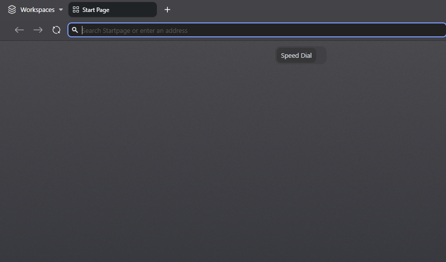

# vivaldi bangs

**Helium's bangs inside of Vivaldi!**

Search any site straight from the address bar. Type `!yt lofi beats` and you land on YouTube's results,
without going through your default search engine first.

<p align="center">
  
</p>

> [!NOTE]
> This brings the native bangs from the [Helium browser](https://github.com/imputnet/helium) to Vivaldi.
> It's an unofficial project, not affiliated with Helium or Vivaldi.

## Features

- **13,000+ bangs**: `!w` Wikipedia, `!gh` GitHub, `!yt` YouTube, `!r` Reddit, `!a` Amazon, `!imdb`, `!so`, and many more.
- **Bangs anywhere**: `!gh react`, `react !gh` and `react !gh hooks` all work.
- **Keyword mode**: type a bang and press <kbd>Space</kbd>, and it becomes a chip like **Search GitHub**. Then just type your search.
- **Suggestions**: start typing `!` to see matching bangs, and press <kbd>Tab</kbd> to pick the top one.
- **AI chatbots** like `!kai`, `!chatgpt` and `!claude` get an **Ask …** chip.
- **Native feel**: uses your theme's colours, follows Vivaldi's animation setting, and works with your usual new-tab and background-tab shortcuts.

## How to use

| Type | Result |
|---|---|
| `!w helium` <kbd>Enter</kbd> | Searches Wikipedia for "helium" |
| `rust lifetimes !so` <kbd>Enter</kbd> | Searches Stack Overflow, with the bang at the end |
| `!gh` <kbd>Space</kbd> | Switches to keyword mode: type your search, then <kbd>Enter</kbd> |
| `!yt` <kbd>Enter</kbd> | Opens the site itself |

To leave keyword mode, press <kbd>Backspace</kbd> at the start of the text, or <kbd>Esc</kbd>.

> [!TIP]
> If one of your Vivaldi search engines already uses a nickname like `!w`, your own engine always takes priority.

## Install

> [!WARNING]
> This changes Vivaldi's own files. It's a common way to mod Vivaldi, but it's at your own risk, and a future Vivaldi version could break it.

1. Download this repository as a ZIP and extract it, or clone it.
2. In the extracted folder, open PowerShell and run:

   ```powershell
   powershell -ExecutionPolicy Bypass -File .\install.ps1
   ```

3. Restart Vivaldi.

> [!IMPORTANT]
> **Run the installer again after every Vivaldi update.** Updates replace the modified file, and bangs stop working until you do.

To uninstall, run `install.ps1 -Uninstall` the same way, then restart Vivaldi.

> [!NOTE]
> The installer is for Windows. On macOS or Linux, copy `helium-bangs.js` into Vivaldi's `resources/vivaldi` folder,
> and add `<script src="helium-bangs.js"></script>` before `</body>` in `window.html`.

## Privacy

The bang list is downloaded from Helium's bangs service, which [doesn't log or track anything](https://github.com/imputnet/helium-services/tree/main/svc/bangs).
It's fetched without cookies and refreshed at most once a day. **Your searches go directly to the site you chose**:
nothing about them is sent to Helium, and nothing goes through your default search engine.

## Settings

Open `helium-bangs.js`, change the options at the top, then run the installer again:

- `enabled`: turn bangs on or off.
- `servicesOrigin`: use your own [self-hosted Helium services](https://github.com/imputnet/helium-services) for the list.

## Credits

- [Helium](https://github.com/imputnet/helium) by imput, for the original bangs feature and the bang service.
- [Kagi's bang list](https://github.com/kagisearch/bangs) (MIT), where the bangs come from.
